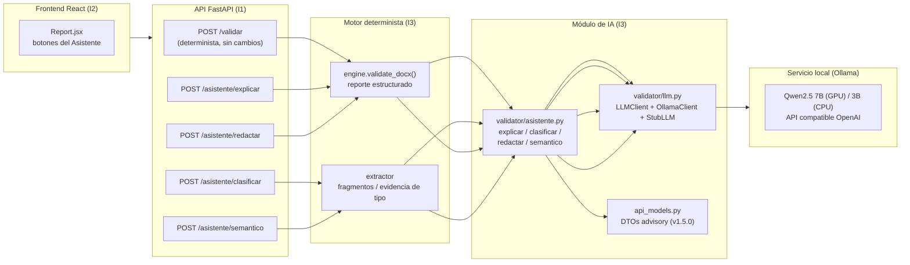

# 16. Módulo de IA local (asistente del encargado)

- **Fecha**: 2026-10-12
- **Estado**: base (Paso 0), y **Funcionalidades 2, 3 y 5** (motor)
  implementadas; API/frontend pendientes (ver `docs/HANDOVER_API_IA.md`)
- **Commits**: — (Semana 8 — rama `semana8-modulo-ia`)
- **Alcance**: fundamento (cliente LLM local) + funcionalidades 2, 3, 5 y 1

Este documento es el **único** (junto al 15) que se escribe **antes** de
implementar: define qué construye el módulo de IA, cómo, y por qué se decidió
así. No hay código aún.

---

## 1. Decisión: la restricción "sin LLM en runtime" cambia

El proyecto se construyó con una restricción dura: *validación 100%
determinista, sin LLM en runtime* (D6 en `01_arq_motor.md`). El alcance de la
semana 7 (issues del handover) se cerró respeando esa restricción. Con este
diseño el equipo agrega un módulo de IA **local y advisory** que convive con el
motor determinista **sin desdibujarlo**:

- El motor determinista (semáforo, `RuleResult`, reglas YAML) **no se modifica**.
- La IA **lee** lo que el motor ya produjo y **responde al encargado**; nunca
  decide el verde/rojo.

## 2. Usuario y alcance

- **Usuario**: el encargado (operador/bibliotecario de la FECyC). No el
  estudiante.
- **Funcionalidades en alcance** (del doc de discusión):
  - **2 — Explicación y priorización del diagnóstico** (la "Fase C" de `15_tipo_documento_grupos.md`).
  - **3 — Clasificación asistida del tipo documental** (human-in-the-loop).
  - **5 — Redacción de la respuesta al estudiante**.
  - **1 — Validación semántica advisory**.
- **Funcionalidades descartadas por ahora**: 4 (RAG del reglamento), 6 (auto-fix del
  DOCX), 7 (herramienta interna de desarrollo).
- **Orden de implementación**: 2 → 3 → 5 → 1.

## 3. Principios de diseño (no negociables)

| # | Principio | Por qué |
|---|-----------|---------|
| P1 | El LLM **jamás** produce `RuleResult` ni toca el semáforo | Garantía central del producto: el verde/rojo es determinista y auditable |
| P2 | Todo resultado de IA es **advisory** (DTO propio) o **human-in-the-loop** (confirmación) | Ninguna salida del LLM decide por sí sola |
| P3 | La IA corre **bajo demanda** (botón), nunca dentro de cada `POST /validar` | Latencia CPU: 200 tokens ≈ 1-2 min; no bloquear la validación normal |
| P4 | Las tesis **no salen del servidor** | LLM local; las funcionalidades 2, 3 y 5 ni siquiera leen la tesis (solo el reporte) |
| P5 | La suite/CI **sigue verde sin GPU ni modelos** | Interfaz `LLMClient` + `StubLLM` determinista |
| P6 | Sin estado persistente (sin DB) | Consistente con el MVP; cada request es autocontenida |
| P7 | Contrato API **aditivo tipado** (v1.5.0) | No rompe `POST /validar` ni `incluir_prompts_ia` |

## 4. Arquitectura general



- Los endpoints del Asistente son **stateless**: reciben el `.docx` (multipart),
  corren la validación determinista localmente (rápida) y sobre su salida llaman
  a la IA. Así no hace falta guardar el reporte intermedio en memoria/BD.
- El servicio Ollama corre en el mismo servidor (`http://127.0.0.1:11434`). Si
  la biblioteca tiene poca máquina, se puede deploiar en otra workstation de la
  LAN institucional (sigue siendo on-premise).

## 5. Cliente LLM (`validator/llm.py`)

### 5.1 Interfaz

```python
@dataclass(frozen=True)
class LLMConfig:
    url: str = ""                  # vacío = módulo deshabilitado
    model: str = "qwen2.5:3b"      # GPU: "qwen2.5:7b"
    timeout_s: float = 180.0

class LLMClient(Protocol):
    @property
    def modelo(self) -> str: ...
    async def chat(self, system: str, user: str, json_schema: dict | None = None) -> str: ...
    async def disponible(self) -> bool: ...   # GET {url}/api/tags

class OllamaClient:
    # POST {url}/api/chat  con format="json" cuando hay json_schema
    ...

class StubLLM:
    # respuestas fijas para tests/CI; no llama a nada
    ...
```

- `get_llm_client(cfg|None) -> LLMClient`: lee `OLLAMA_URL`, `OLLAMA_MODEL`,
  `OLLAMA_TIMEOUT` del entorno (variables que **no** van a `verificar_secretos`:
  no son credenciales). Si falta `OLLAMA_URL` → `LLMNoDisponible`.
- `estado_ia(cfg|None, *, client=None) -> {"disponible": bool, "modelo": str}`:
  alimenta el estado "deshabilitado" del frontend; nunca lanza.

### 5.2 JSON estructurado

- Cada feature pide salida JSON con un **esquema acotado** (`json_schema`).
  Ollama soporta `format: json` (devuelve el primer JSON válido) y también
  schema estricto; como mínimo aplicamos parse + validación Pydantic del DTO.
- Ante JSON inválido: **un reintento** con el mismo prompt; si vuelve a fallar,
  el endpoint responde `422` de módulo IA ("la IA no devolvió un formato
  interpretable"), jamás mezcla salida parcial con el reporte.
- Determinismo de prueba: `StubLLM` devuelve JSON válidos fijos por feature.

## 6. Las cuatro funcionalidades en detalle

### 6.1 Funcionalidad 2 — Explicación y priorización (`POST /asistente/explicar`)

- **Entrada**: `.docx` (multipart).
- **Paso determinista**: `engine.validate_docx()` → reporte (reglas fallidas con
  mensaje, esperado/encontrado, cita, ubicación, tipo documental, centinelas).
- **Prompt**: bloque de fallos + contexto por regla; NO se envía la tesis.
- **Salida `ExplicacionYPrioridad`**:

```json
{
  "explicaciones": [
    {"rule_id": "...", "explicacion": "..."}
  ],
  "prioridades": [
    {"orden": 1, "rule_id": "...", "razon": "...", "esfuerzo": "bajo|medio|alto"}
  ]
}
```

- Los campos nunca alteran `semaforo`; se muestran en acordeones bajo la tabla.
- **Frontend (I2)**: botón "Explicar por qué falló" por regla y "Priorizar
  correcciones" global; estado de carga y de "IA no disponible".

### 6.2 Funcionalidad 3 — Clasificación asistida (`POST /asistente/clasificar`)

- **Entrada**: `.docx` (multipart).
- **Detección**: si `deteccion_tipo_documento` devolvió `sin_determinar`,
  `contradictorio` o tipo con `tipo_documento_sin_estructura`, se activa el
  asistente. Se envía la **evidencia** que usó la heurística (títulos
  detectados, firmas buscadas, declaración del Anexo 10) — no la tesis entera.
- **Salida `ClasificacionPropuesta`**:

```json
{
  "tipo_propuesto": "tinv_cuantitativo",
  "confianza": 0.87,
  "justificacion": "...",
  "evidencia": ["...", "..."],
  "alternativas": ["tinv_cualitativo", "proyecto_cuantitativo"]
}
```

- **Human-in-the-loop**: el encargado confirma o corrige. Al confirmar, el
  frontend revalida con **`POST /validar?tipo_confirmado=tinv_cuantitativo`**
  (ver §7): el motor omite la inferencia y usa el tipo indicado. Nunca el LLM
  cambia el tipo solo.

### 6.3 Funcionalidad 5 — Redacción de la respuesta al estudiante (`POST /asistente/redactar`)

- **Entrada**: `.docx` (multipart) + opcional `tipo_confirmado`.
- **Pasos**: reporte determinista → prompt con fallos ordenados → texto editable.
- **Salida `RedaccionRespuesta`**:

```json
{
  "texto": "...",
  "asunto": "..."
}
```

- Regla dura: la IA **solo** usa los fallos del reporte (prohibido inventar
  observaciones). El encargado **edita antes de enviar**; el envío sigue siendo
  el flujo SMTP actual (`notificacion.py`, área de I1), no se automatiza aquí.

### 6.4 Funcionalidad 1 — Validación semántica advisory (`POST /asistente/semantico`)

- **Entrada**: `.docx` (multipart).
- **Fragmentos** (los ya extraíbles por el extractor): resumen, tabla de
  contenidos, lista de referencias, títulos de capítulo. Capa la longitud
  (p. ej. resumen ≤ 2.000 caracteres; referencias por páginas ¿primera y
  última).
- **Checks semánticos** por ahora: coherencia resumen↔contenido; índice↔títulos
  reales; horfandad/chic de citas (solo presencia de patrón). Cada check es un
  prompt con **la regla textual + el fragmento**, no el reglamento completo.
- **Salida `HallazgosSemanticos`**:

```json
{
  "hallazgos": [
    {"check": "indice_vs_titulos", "nivel": "advertencia|informativo",
     "descripcion": "...", "ubicacion": "página 12"}
  ]
}
```

- Es **advisory**: nunca bloquea la entrega. Los hallazgos no entran al
  semáforo ni al resumen; se muestran en una sección separada "Revisión
  semántica".

## 7. Contrato API v1.5.0 (aditivo)

| Campo / endpoint | Cambio | Área |
|------------------|--------|------|
| `GET /asistente/estado` | Nuevo: `{disponible: bool, modelo: str}` para que el frontend pinte el botón deshabilitado | I1 |
| `POST /asistente/explicar` | Nuevo (Funcionalidad 2) | I1 |
| `POST /asistente/clasificar` | Nuevo (Funcionalidad 3) | I1 |
| `POST /asistente/redactar` | Nuevo (Funcionalidad 5) | I1 |
| `POST /asistente/semantico` | Nuevo (Funcionalidad 1) | I1 |
| `POST /validar?tipo_confirmado=` | Nuevo query param: si viene, el motor **omite la inferencia** y usa ese tipo (requiere toque acotado en el flujo de compilación: `sobreescribir_tipo`) | I1 + I3 |

- Códigos: `200` DTO advisory; `503` "módulo de IA no disponible" (patrón del
  estado deshabilitado que ya implementó `notificacion.py`); `422` si la IA no
  devuelve JSON interpretable.
- Todos los DTOs van en `api_models.py` con validación Pydantic y campos en
  español (convención del proyecto).
- `POST /validar` y `incluir_prompts_ia` quedan **exactamente igual**.

## 8. Seguridad y privacidad

- No se despliega ningún secreto: `OLLAMA_URL`/`OLLAMA_MODEL` son configuración,
  no credenciales → `scripts/verificar_secretos.py` no cambia.
- Las tesis viven solo en el servidor/red LAN institucional; nunca a un servicio
  externo.
- Las funcionalidades 2, 3 y 5 **no leen el cuerpo de la tesis** (solo el reporte o la
  evidencia de detección); la funcionalidad 1 sí (fragmentos), local.
- Tiempos de espera acotados (`OLLAMA_TIMEOUT`) para que un modelo colgado nunca
  tenga en vilo al encargado.

## 9. Testing y CI

- **`StubLLM`**: respuestas JSON fijas por feature → tests de contrato y unit
  sin GPU ni descargas. La suite actual (490 tests) debe seguir en verde.
- Marco de pruebas: tests de **prompt building** (sin red), tests de **parsing
  JSON→DTO** (torturas: llaves rotas, arrays vacíos, campos de más), tests de
  **contrato de endpoint** (Con `StubLLM` inyectado vía `app.dependency_overrides`).
- **Integración real con Ollama**: opcional, marcada con `@pytest.mark.ia` y
  **saltada** si no hay `OLLAMA_URL` (el CI no la corre).
- `ruff`, `mypy`, `nix flake check` siguen siendo los guardianes del CI.

## 10. Orden de implementación (aún NO se ejecuta)

| Paso | Contenido | Depende de |
|------|-----------|------------|
| 0 ✅ | `validator/llm.py` (protocol + Ollama + Stub) + config + `estado_ia()` (endpoint `GET /asistente/estado` pendiente de I1) | — |
| 1 ✅ (motor) | Funcionalidad 2: `explicar_y_priorizar()`; endpoint + frontend pendientes de I1/I2 | Paso 0 |
| 2 ✅ (motor) | Funcionalidad 3: `proponer_clasificacion()`; endpoint + `tipo_confirmado` pendientes de I1 | Paso 0, coord. I1 |
| 3 ✅ (motor) | Funcionalidad 5: `redactar_respuesta()`; endpoint pendiente de I1 (coord. SMTP) | Paso 0, coord. I1 (SMTP) |
| 4 | Funcionalidad 1: `revision_semantica()` + fragmentos + endpoint | Pasos 0–3 |

Cada paso termina con: DTO validado, tests stub/contrato verdes, `ruff`+`mypy`
limpios, bitácora, y (si aplica) actualización de `README.md` y del
`AGENTS.md` (la restricción "sin LLM runtime" cambia — requiere aprobación del
usuario).

## 11. Coordinación y límites (AGENTS.md)

| Tarea | Responsable |
|-------|-------------|
| `validator/llm.py`, `validator/asistente.py`, tests del módulo | Integrante 3 (motor) |
| Endpoints en `api.py`, DTOs en `api_models.py`, `docs/CONTRATO_API.md`, OpenAPI | Integrante 1 (backend) — coordina límites |
| Frontend (botones, estados, secciones nuevas) | Integrante 2 — coordina contrato |
| Re-validación con `tipo_confirmado` (toque en flujo de compilación) | I3 propone, coordina con I1 antes de tocar `api.py`/`api_models.py` |

## 12. Mapeo académico

| Concepto | Dónde | Área académica |
|----------|-------|----------------|
| LLM local y generación de explicaciones | §5–§6 | Inteligencia Artificial II — representación del conocimiento y explicabilidad |
| JSON estructurado validado (Pydantic) | §5.2, §7 | Ingeniería de Software I/II — contratos tipados |
| Clasificación asistida con humano en el medio | §6.2 | Metodología de la Investigación — tipos de investigación |
| HTTP async sin bloquear el event loop | §5, §7 | Redes de Computadoras I — HTTP/REST |
| Pruebas con doble de prueba (`StubLLM`) | §9 | Ingeniería de Software — testing con doubles |
| Configuración por entorno sin secretos | §5.1, §8 | Ingeniería de Software — 12-factor |

## 13. Relación con el diseño existente

- `15_tipo_documento_grupos.md`: la funcionalidad 3 cierra su "Fase C" (explicación y
  priorización) y complementa sus centinelas con clasificación asistida.
- `10_calidad_y_exportacion.md`: el reporte Markdown/PDF puede sumar la sección
  "Revisión semántica" (paso 4) como bloque opcional.
- `README.md` §Extensiones futuras: describe ya el camino (LLM local vía
  Ollama, después de las reglas deterministas, con fragmentos acotados); se
  actualizará cuando el módulo exista.
- `PLAN_BACKLOG_FUTURO.md`: la IA pasa de "fuera hasta que el integrante lo
  indique" a "definida en el diseño 16" (no descartada del backlog; el Bloque B
  de explicabilidad sin IA sigue siendo complementario).